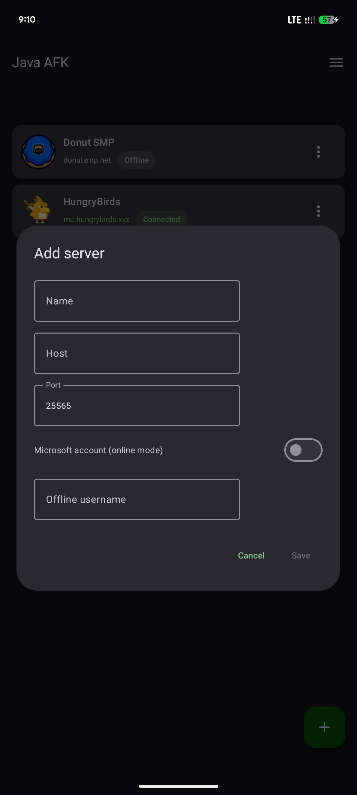
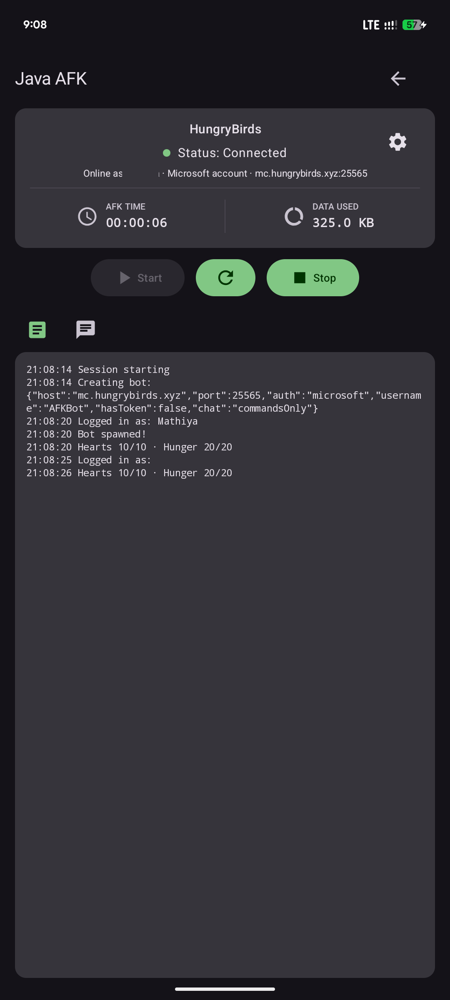

# Java AFK NaNo  
**Lightweight Android Minecraft Java AFK Bot**

## Overview

Java AFK NaNo is the lightweight edition of Java AFK. It is built for users who want a simple, low-usage AFK bot without the heavier embedded Node.js runtime. Credits to kakashi lite for making the engine :)

<!-- Demo GIF: replace with Screenshots/demo.gif once uploaded -->
<!--

  

-->

## Core Capabilities

- **Pure Kotlin implementation** — no embedded Node.js runtime
- **Low RAM usage**
- **Lower data usage**
- **Lightweight APK (~3 MB)**
- **Multi-bot friendly without a fixed limit**
- **Broad Minecraft Java version support (`1.8` – `26.1`)**

## Comparison

| | Java AFK | Java AFK NaNo |
| :--- | :--- | :--- |
| **Engine** | Embedded Node.js + Mineflayer | Pure Kotlin |
| **Bot Limit** | 5 bots | No fixed limit |
| **RAM Usage** | Higher | Lower |
| **Data Usage** | Higher | Lower |
| **Best For** | Full-featured AFK sessions | Lightweight long-running AFK |

## Feature Availability

| Feature | Java AFK | Java AFK NaNo |
| :--- | :---: | :---: |
| **In-game menu / window handling** | ✅ | ❌ |
| **Low data usage** | ❌ | ✅ |
| **Low RAM usage** | ❌ | ✅ |
| **No fixed bot limit** | ❌ | ✅ |

> Java AFK provides more advanced bot visibility, including menu/window handling.  
> Java AFK NaNo focuses on staying lightweight, stable, and efficient.

## Supported Versions

Java AFK NaNo supports **46 Minecraft Java Edition protocol versions** from **1.8 through 26.1** (with automatic server version detection and manual protocol override):

- **1.8:** `1.8`
- **1.9 – 1.11:** `1.9`, `1.9.2`, `1.9.4`, `1.10.2`, `1.11`, `1.11.2`
- **1.12 – 1.15:** `1.12`, `1.12.1`, `1.12.2`, `1.13`, `1.13.1`, `1.13.2`, `1.14`, `1.14.1`, `1.14.3`, `1.14.4`, `1.15`, `1.15.1`, `1.15.2`
- **1.16 – 1.19:** `1.16`, `1.16.1`, `1.16.2`, `1.16.3`, `1.16.5`, `1.17`, `1.17.1`, `1.18.1`, `1.18.2`, `1.19`, `1.19.2`, `1.19.3`, `1.19.4`
- **1.20 – 1.21:** `1.20.1`, `1.20.2`, `1.20.4`, `1.20.6`, `1.21.1`, `1.21.3`, `1.21.4`, `1.21.5`, `1.21.6`, `1.21.8`, `1.21.10`, `1.21.11`
- **26.x:** `26.1`

## Preview

  
  

## Quick Start

1. Install the latest APK from the [Releases](../../releases) page.
2. Add your server.
3. Tap **Start**.
4. Sign in if required.
5. The bot connects and stays online with minimal resource usage.

## Security & Privacy

Minecraft players are right to be careful with apps that sign in to Microsoft accounts. Here is how Java AFK NaNo handles your data:

- **Encrypted local token storage:** Microsoft/Minecraft session tokens are encrypted using a non-exportable **AES-GCM 256-bit key in the Android Keystore** (`KeystoreTokenStore`) and are never logged or stored in plaintext.
- **No cloud backups:** `android:allowBackup="false"` is set in the manifest so encrypted session data is never backed up off your device.
- **Direct connections only:** Your device connects directly to official Microsoft/Xbox/Mojang authentication endpoints, Cloudflare DNS-over-HTTPS (for `_minecraft._tcp` SRV lookups), and the Minecraft servers you configure. There is no third-party relay, telemetry, or analytics server.
- **100% open-source:** The entire protocol engine and Android app are licensed under **GPLv3** and fully auditable in this repository.

## Is This Legal? Can My Minecraft Account Get Banned?

Here is the honest truth:

- **Not illegal:** Using an open-source Minecraft protocol client to AFK on your own server or a server that allows AFK accounts is not illegal.
- **Mojang / Microsoft account bans:** Mojang does not globally ban Microsoft accounts simply for connecting with a custom headless client. (Note: chat messages sent by this app are unsigned, so servers that strictly require signed chat may reject chat messages.)
- **Server-level bans ARE possible:** Every Minecraft server sets its own rules. Many public, minigame, competitive, or economy servers (for example, servers with strict anti-AFK, anti-bot, or anti-alt policies) forbid AFK clients or automated reconnect/anti-AFK behavior. **If you break a server's rules, that server's staff or anti-cheat can kick or ban you from that server.**
- **Best practice:** Only use Java AFK NaNo on your own servers, private SMPs, or public servers where AFK clients/bots are explicitly permitted.

## Feedback, Ideas & Bug Reports

Have a feature idea, found a bug, or having trouble connecting to a server?  
Please open an issue on the [GitHub Issues](../../issues) page — bug reports and suggestions are always welcome!

## License

This project is licensed under the **GNU General Public License v3.0** — see [LICENSE](./LICENSE) for details.
