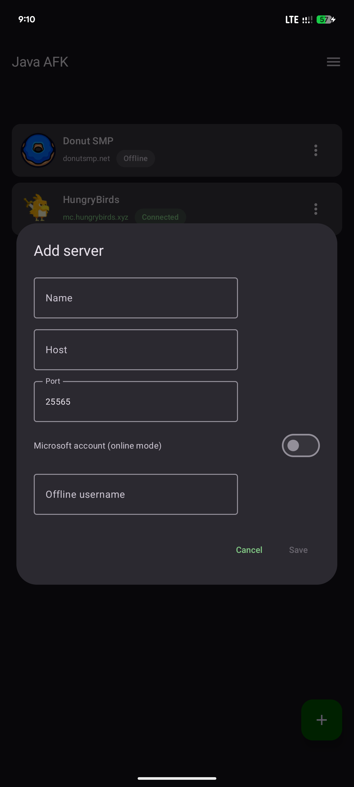
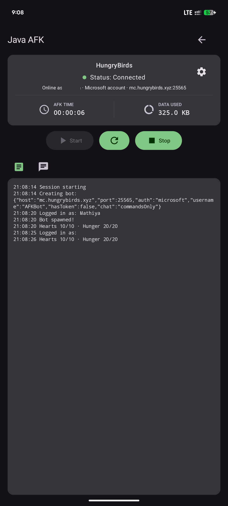

# Java AFK NaNo  
**Lightweight Android Minecraft Java AFK Bot**

## Overview

Java AFK NaNo is the lightweight edition of Java AFK. It is built for users who want a simple, low-usage AFK bot without the heavier embedded Node.js runtime.

## Core Capabilities

- **Pure Kotlin implementation**
- **Low RAM usage**
- **Lower data usage**
- **Lightweight APK**
- **Multi-bot friendly without a fixed limit**

## Comparison

| | Java AFK | Java AFK NaNo |
| :--- | :--- | :--- |
| **Engine** | Embedded Node.js + Mineflayer | Pure Kotlin |
| **Bot Limit** | 5 bots | No fixed limit |
| **RAM Usage** | Higher | Lower |
| **Data Usage** | Higher | Lower |
| **Best For** | Full-featured AFK sessions | Lightweight long-running AFK |

## Feature Availability

| Feature | Java AFK | Java AFK NaNo |
| :--- | :---: | :---: |
| **In-game menu / window handling** | ✅ | ❌ |
| **Low data usage** | ❌ | ✅ |
| **Low RAM usage** | ❌ | ✅ |
| **No fixed bot limit** | ❌ | ✅ |

> Java AFK provides more advanced bot visibility, including menu/window handling.  
> Java AFK NaNo focuses on staying lightweight, stable, and efficient.

## Preview

  
  

## Quick Start

1. Install the latest APK from the [Releases](../../releases) page.
2. Add your server.
3. Tap **Start**.
4. Sign in if required.
5. The bot connects and stays online with minimal resource usage.
